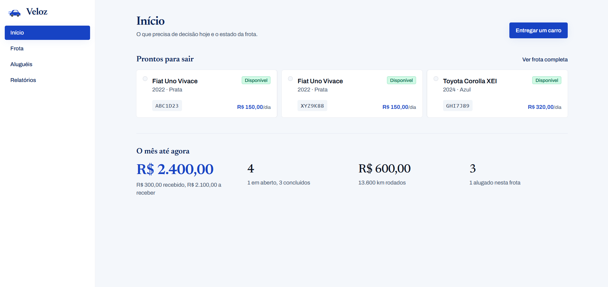

# aluguel

> API de registro de aluguel de veículos: quem pegou qual carro, quando, por
> quantos km e por quanto — com os dados da pessoa protegidos por lei.

Uma locadora precisa de duas coisas que se comportam de forma incompatível: o
**negócio** (quem pegou qual carro, por quantos dias, a quantos quilômetros e por
quanto — precisa somar, agrupar e filtrar) e a **pessoa** (nome, CPF, e-mail,
telefone, CNH — precisa não ser legível por quem acessa o banco).

Cifra e relatório não combinam: um valor cifrado não pode ser somado nem
ordenado. Este projeto resolve isso separando cada dado **pelo uso que ele tem**,
não pelo tipo:

- **Nenhum dado pessoal fica legível no banco** — nome, CPF, e-mail, telefone,
  CNH e observações são gravados com **AES-256-GCM**.
- **A busca continua funcionando** — cada campo pesquisável tem um índice **HMAC**
  (*blind index*) que permite achar o registro sem revelar o valor.
- **As chaves são obrigatórias** — a aplicação se recusa a subir sem elas. Não
  existe chave padrão embutida no código.
- **Nenhuma coluna cifrada é ordenável** — por decisão explícita. Ordenar material
  cifrado não produz ordem nenhuma e ainda confirmaria a existência da coluna para
  quem sonda o schema.

O mesmo CPF existe no banco em duas formas: um índice determinístico que permite
encontrá-lo, e um texto cifrado que permite exibi-lo. Nenhuma das duas revela o
valor sozinha.

---

## Como funciona

**1. O dado entra e é classificado pelo uso.** Datas, valores e quilometragem vão
em claro, porque os relatórios filtram e somam por eles. Dados pessoais vão
cifrados. Campos pesquisáveis ganham também o índice HMAC.

**2. O aluguel guarda os dados da pessoa.** Não existe cadastro de cliente
separado: nome, CPF, e-mail, telefone e CNH vão direto no `POST /api/v1/alugueis`.
CPF pode se repetir — ele serve à busca, nunca à identidade
([ADR-0003](docs/adr/0003-aluguel-guarda-dados-pessoais.md)).

**3. Os relatórios operam só sobre o que está em claro.** O fechamento do período
soma receita, conta aluguéis e agrega quilometragem sem tocar em nenhum dado
cifrado.

## O que torna isso não-óbvio

Guardar um dado pessoal exige **três passos em ordem**, e a normalização certa
depende do campo: nome colapsa acento e caixa, documento remove pontuação. Errar
o pareamento **compila, passa em qualquer teste de comportamento e quebra a busca
em produção** — o registro grava normalmente, e o defeito só aparece depois,
quando a consulta não encontra nada.

Para eliminar essa classe de bug, o projeto tem um tipo que carrega o par
índice + cifra já calculado com a normalização correta (`CampoProtegido`). O papel
do dado escolhe a normalização *dentro* do tipo, então parear errado deixa de ser
expressável. A decisão está em
[`docs/adr/0004-campo-protegido.md`](docs/adr/0004-campo-protegido.md).

## Demonstração



---

## Como rodar

Precisa de **JDK 25** e **Docker**. O Gradle vem pelo wrapper, não instale nada.

**1. Gere as duas chaves.** A aplicação não sobe sem elas, e isso é intencional:
uma chave padrão embutida no código seria pior que não ter proteção nenhuma.

```bash
cp .env.exemplo .env
openssl rand -base64 32   # cole em LOCADORA_DADO_PESSOAL_INDICE_CHAVE
openssl rand -base64 32   # cole em LOCADORA_DADO_PESSOAL_CIFRA_CHAVE
```

O `.env` é ignorado pelo git. Perder a chave de cifra torna os dados pessoais
definitivamente ilegíveis.

**2. Suba tudo.**

```bash
docker compose up --build -d
docker compose ps
```

A API responde em `http://localhost:8080`.

<details>
<summary>Alternativa: rodar sem Docker (banco separado)</summary>

```bash
docker compose up -d aluguel-db   # só o Postgres
./gradlew bootRun                 # com as variáveis de ambiente exportadas
```

</details>

**3. Rode os testes.**

```bash
./gradlew test
```

São 66 testes, em H2 na memória — não precisam de Postgres nem das chaves
externas.

**4. Experimente.**

```bash
# cadastra um carro
curl -i -X POST http://localhost:8080/api/v1/carros \
  -H "Content-Type: application/json" \
  -d '{"nome":"Uno","marca":"Fiat","modelo":"Uno Vivace","ano":2022,
       "placa":"XYZ9K88","quilometragem":10000,"cor":"Prata",
       "categoria":"Economico","valorDiaria":150.00}'

# registra um aluguel (os dados da pessoa vão aqui)
curl -i -X POST http://localhost:8080/api/v1/alugueis \
  -H "Content-Type: application/json" \
  -d '{"nome":"Joao Lima","cpf":"529.982.247-25","email":"joao@email.com",
       "telefone":"11988887777","cnh":"CNH12345","carroId":"<ID DO CARRO>",
       "dataPrevistaDevolucao":"2026-10-27T10:00:00"}'

# fecha o caixa do período
curl "http://localhost:8080/api/v1/relatorios/movimentacao?de=2026-10-01T00:00:00&ate=2026-10-31T23:59:59"
```

---

## Contrato da API

<details>
<summary><b>Todos os endpoints, payloads e códigos de erro</b></summary>

Todo `POST`/`PUT`/`PATCH` com corpo espera `Content-Type: application/json`.

### Carros — `/api/v1/carros`

| Método | Rota | Descrição |
|---|---|---|
| POST | `/` | Cadastra carro (`201` + header `Location`) |
| GET | `/{id}` | Busca por id |
| GET | `/por-placa/{placa}` | Busca por placa (ignora formatação) |
| GET | `/` | Lista paginada |
| GET | `/disponiveis` | Lista carros disponíveis |
| PUT | `/{id}` | Atualiza dados cadastrais |
| PATCH | `/{id}/status` | Altera status |
| PUT | `/{id}/placa` | Altera placa |
| PUT | `/{id}/quilometragem` | Registra quilometragem (só cresce) |
| DELETE | `/{id}` | Remove (`204`; bloqueado se houver aluguel) |

Filtros da listagem: `marca`, `status`, `pagina`, `tamanho`, `ordenarPor`,
`direcao`.

**Status:** `DISPONIVEL`, `ALUGADO`, `MANUTENCAO`, `DESATIVADO`.

```
DISPONIVEL ─┬─> ALUGADO ─┬─> DISPONIVEL
            │            └─> MANUTENCAO
            ├─> MANUTENCAO ─┬─> DISPONIVEL
            │               └─> DESATIVADO
            └─> DESATIVADO      (terminal)
```

Payload de cadastro:

```json
{
  "nome": "Uno",
  "marca": "Fiat",
  "modelo": "Uno Vivace",
  "ano": 2022,
  "placa": "ABC1D23",
  "quilometragem": 10000,
  "cor": "Prata",
  "categoria": "Economico",
  "valorDiaria": 150.00
}
```

Validações: `nome`/`marca`/`modelo`/`placa` obrigatórios · `ano ≥ 1900` · `placa`
casa `^[0-9A-Za-z\-\s]{7,10}$` · `quilometragem ≥ 0` · `valorDiaria ≥ 0.01`.
Placa é única — repetir retorna `422`.

### Aluguéis — `/api/v1/alugueis`

| Método | Rota | Descrição |
|---|---|---|
| POST | `/` | Registra aluguel com os dados da pessoa (`201` + `Location`) |
| GET | `/{id}` | Busca por id |
| GET | `/` | Lista paginada (filtros: `carroId`, `status`) |
| PATCH | `/{id}/devolucao` | Registra devolução |
| PATCH | `/{id}/pagamento` | Registra pagamento (somente após devolução) |
| PATCH | `/{id}/cancelamento` | Cancela o aluguel (corpo opcional) |

**Status do aluguel:** `ATIVO`, `CONCLUIDO`, `CANCELADO`.
**Status de pagamento:** `PENDENTE`, `PAGO`, `CANCELADO`.

Payload de registro:

```json
{
  "nome": "Joao Lima",
  "cpf": "529.982.247-25",
  "email": "joao.lima@email.com",
  "telefone": "11988887777",
  "cnh": "12345678901",
  "carroId": "<UUID do carro>",
  "dataPrevistaDevolucao": "2026-10-27T10:00:00",
  "observacoes": "Cliente pediu cadeirinha"
}
```

Opcionais: `dataInicio` (padrão: agora), `quilometragemInicial` (padrão: do
carro), `valorDiaria` (padrão: do carro), `observacoes`.

Na resposta, `pessoa` traz `{ id, nome, cpf }` **decifrados** (o `id` é o do
próprio aluguel). `observacoes` aparece só no detalhe (`GET /{id}`), nunca na
listagem.

Devolução: `{ "dataDevolucao": "...", "quilometragemFinal": 10250 }` — a
quilometragem é obrigatória e não pode ser menor que a inicial.
Cancelamento: `{ "motivo": "cliente desistiu" }` — o corpo inteiro é opcional.

### Relatórios — `/api/v1/relatorios`

| Método | Rota | Descrição |
|---|---|---|
| GET | `/movimentacao` | Fechamento financeiro do período |
| GET | `/movimentacao-por-carro` | Ranking agregado por carro |

`de` e `ate` são obrigatórios, em ISO-8601. Um aluguel entra no relatório se
**sobrepõe** o período, mesmo parcialmente; cancelados não entram nas somas.

`movimentacao` devolve `totalAlugueis`, `totalAtivos`, `totalConcluidos`,
`receitaTotal`, `receitaPaga`, `receitaPendente`, `ticketMedio`,
`quilometragemPercorrida`. `movimentacao-por-carro` agrega os mesmos números por
carro, mais `percentualDaReceita`.

### Paginação

Todas as listagens devolvem o mesmo envelope:

```json
{
  "conteudo": [],
  "pagina": 0,
  "tamanho": 20,
  "totalElementos": 1,
  "totalPaginas": 1,
  "primeira": true,
  "ultima": true
}
```

Parâmetros: `pagina` (base 0), `tamanho`, `ordenarPor`, `direcao`. **Campos
ordenáveis são uma lista fechada por endpoint** — campos cifrados e `observacoes`
ficam de fora de propósito. Um campo fora da lista retorna `422`, não `500`.

### Erros

Formato **ProblemDetail (RFC 7807)**: `type`, `title`, `status`, `detail`,
`instance`. Erros de validação incluem `erros: [{ campo, mensagem }]`.

| Status | Quando |
|---|---|
| `400` | Corpo/parâmetro inválido (Bean Validation) |
| `404` | Recurso não encontrado |
| `422` | Regra de negócio violada — carro já alugado, placa repetida, km retrocede, pagamento antes da devolução, período inválido |
| `409` | Conflito de integridade de dados |
| `500` | Erro inesperado |

</details>

## Modelo de dados

<details>
<summary><b>Colunas cifradas, índices HMAC e o que fica em claro</b></summary>

**`carros`** — dados do veículo. A placa é dado pessoal: `placa_indice` (HMAC,
único) + `placa_cifrada` (AES-GCM).

**`alugueis`** — vínculo entre carro e pessoa no período.

| Grupo | Colunas |
|---|---|
| Cifradas (AES-256-GCM) | `nome_cifrado`, `cpf_cifrado`, `email_cifrado`, `telefone_cifrado`, `cnh_cifrado`, `observacoes_cifradas` |
| Índices HMAC | `nome_indice`, `cpf_indice`, `cnh_indice` |
| Em claro | datas, `quilometragem*`, `valor_*`, `status`, `status_pagamento` |

Três decisões que esse desenho carrega:

1. **CPF pode se repetir.** A mesma pessoa pode ter vários aluguéis, então
   `cpf_indice` não tem constraint de unicidade — ele serve à busca, nunca à
   identidade.
2. **Datas, valores e quilometragem ficam em claro** porque os relatórios filtram
   e somam por eles, e cifra não suporta nenhuma das duas operações.
3. **O índice HMAC é *keyed*.** Sem a chave, quem obtém o banco não consegue nem
   calcular o índice para comparar contra um CPF suspeito — o vazamento não
   permite força bruta.

</details>

---

## Decisões de arquitetura

Cada uma existe por um motivo, e o motivo está registrado:

| Decisão | Por quê |
|---|---|
| [ADR-0001](docs/adr/0001-simplicidade-didatica-sobre-abstracoes.md) — Simplicidade didática sobre abstrações | Extrair só quando a duplicação é real e o ganho é claro |
| [ADR-0002](docs/adr/0002-padrao-respostas-controllers.md) — Padrão de respostas dos controllers | `201` + `Location` no POST, `204` no DELETE, DTO direto no resto |
| [ADR-0003](docs/adr/0003-aluguel-guarda-dados-pessoais.md) — O aluguel guarda os dados da pessoa | Não há cadastro de cliente; o dado pessoal vive no próprio aluguel |
| [ADR-0004](docs/adr/0004-campo-protegido.md) — Campo protegido | Normalização + índice + cifra num só ponto, à prova de pareamento errado |

O ADR-0004 registra explicitamente a tensão com o ADR-0001 — a decisão de criar
uma abstração num projeto que prioriza simplicidade — e por que ela venceu mesmo
assim.

O vocabulário do domínio (o que é *movimentação*, *índice*, *papel do dado*) está
em [`GLOSSARY.md`](GLOSSARY.md), com a definição **e** o que cada termo **não** é.

---

## Stack

Spring Boot 4.1.1 · Java 25 · PostgreSQL 16 · Hibernate/JPA · Bean Validation ·
Docker Compose · Gradle · Lombok · JUnit 5 + AssertJ

Arquitetura em camadas (`Controller → Service → Repository`, DTOs na borda),
`open-in-view=false`.

## Documentação

| Arquivo | Conteúdo |
|---|---|
| [`GLOSSARY.md`](GLOSSARY.md) | Vocabulário do domínio e da proteção de dados |
| [`docs/adr/`](docs/adr/) | Decisões de arquitetura, com as alternativas rejeitadas |
| [`docs/HANDOFF_FRONTEND.md`](docs/HANDOFF_FRONTEND.md) | Contrato REST e prioridades de integração |
| [`CONTEXT.md`](CONTEXT.md) | Visão geral, restrições e convenções |
